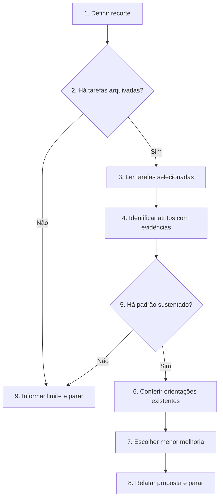

# Encontrar atritos no SDD-Fast

Examine tarefas concluídas e proponha somente melhorias sustentadas por evidências.

## Regras invariantes

1. Siga o Fluxo de decisão pelas setas e condições. Execute somente os blocos do caminho escolhido; Execução detalha os blocos de mesmo número. Se fluxo e texto divergirem, pare e informe o humano.
2. Esta skill é somente de análise: não edite arquivos, implemente código, execute testes nem crie outra skill ou agente.
3. Liste as tarefas arquivadas e leia as do recorte indicado pelo humano ou, sem recorte, todas em `tasks/`. Processe as seções relevantes por lotes; não carregue todo o repositório no contexto de uma vez.
4. Separe fatos registrados, inferências e lacunas. Uma validação aprovada demonstra o comportamento registrado, mas não prova que a execução foi rápida ou sem retrabalho. Não invente duração, causa ou falha.
5. Recomende uma mudança de processo somente com evidência de recorrência ou risco relevante. Um caso isolado pode ser indicado para investigação, sem virar nova regra por padrão.
6. Confira `AGENTS.md`, skills, modelos e orientações existentes antes de propor novos artefatos. As seções fixas de `AGENTS.md` só podem ser alteradas pelo humano; `FUTURE_TASKS.md` só muda mediante pedido explícito.
7. Se não houver evidência suficiente, diga isso e pare. Não produza uma melhoria apenas para preencher o relatório.

## Fluxo de decisão

## Execução

1. **Definir recorte.** Use o intervalo indicado pelo humano ou todas as tarefas arquivadas em `tasks/` do projeto atual. Liste os arquivos e registre o total antes de ler.
2. **Há tarefas arquivadas?** Se houver arquivos no recorte, vá ao item 3; caso contrário, vá ao item 9.
3. **Ler tarefas selecionadas.** Processe em lotes, registrando um resumo curto por tarefa: objetivo, limites, validações, resultados, checkpoint e itens reais de **Atritos no processo de implementação**, quando presentes. Ignore as instruções e os exemplos do template. Consulte Git ou registros relacionados somente se uma hipótese exigir confirmação. Se não conseguir cobrir o recorte inteiro, informe a cobertura e não generalize para tarefas não lidas.
4. **Identificar atritos com evidências.** Procure retrabalho, correções repetidas, tarefas grandes, validações difíceis de auditar e instruções que precisaram ser reiteradas. Para cada sinal, anote os caminhos das tarefas e o fato observável; não deduza atrito da mera existência de uma task.
5. **Há padrão sustentado?** Considere forte um atrito observado em pelo menos duas tarefas, com impacto identificável. Caso isolado de risco alto pode ser relatado como investigação, sem prescrever nova regra. Sem padrão sustentado, vá ao item 9; caso contrário, vá ao item 6.
6. **Conferir orientações existentes.** Leia apenas `AGENTS.md`, skills, templates ou documentos que possam explicar o padrão. Distinga regra ausente de regra existente que não foi seguida.
7. **Escolher menor melhoria.** Prefira usar ou esclarecer uma regra existente; depois considere checklist, template ou skill. Sugira agente especializado somente se houver função distinta e recorrente. Inclua a opção de não mudar nada. Não registre sugestões em `FUTURE_TASKS.md`.
8. **Relatar proposta e parar.** Em poucas linhas, informe quantas tarefas foram examinadas de quantas no recorte; até três achados com tarefas citadas, fato observado, impacto ou risco, recomendação mínima e o que ainda precisa ser confirmado. Não altere arquivos.
9. **Informar limite e parar.** Diga se faltam tarefas, se não houve padrão ou se os registros não permitem avaliar o atrito. Informe quantas tarefas examinou, a cobertura do recorte e, quando útil, qual evidência faltaria. Não altere arquivos.
