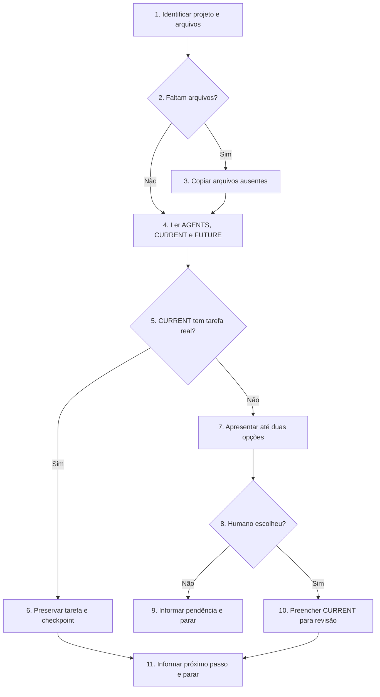

# Iniciar ou retomar SDD-Fast

Prepare os arquivos do método e, se necessário, uma tarefa para revisão humana. As regras permanentes do projeto estão em AGENTS.md.

## Regras invariantes

1. Siga o Fluxo de decisão pelas setas e condições. Execute somente os blocos do caminho escolhido; os itens de Execução detalham os blocos de mesmo número, não formam uma sequência a executar inteira. Se houver conflito entre fluxo e texto, pare e informe o humano.
2. Leia o AGENTS.md existente antes de editar arquivos. Nunca substitua arquivos existentes por modelos nem altere as seções fixas de AGENTS.md. Informe divergências entre elas e o modelo do método.
3. Leia CURRENT_TASK.md e FUTURE_TASKS.md. FUTURE_TASKS.md informa dependências e opções; seus itens não autorizam implementação. Sugira ideias, mas só registre, altere ou remova itens nele mediante pedido explícito do humano.
4. Preserve uma tarefa real e seu checkpoint em CURRENT_TASK.md. Se não houver tarefa real, só preencha o arquivo depois que o humano escolher ou descrever a tarefa; o texto produzido ainda precisa de aprovação.
5. Se faltar modelo, escolha humana ou informação decisiva sobre objetivo, usuário ou limites, informe o bloqueio e pare. Não improvise requisitos.
6. Pare antes de implementar, instalar dependências, executar testes extensos ou arquivar tarefas.

## Fluxo de decisão

## Execução

1. **Identificar projeto e arquivos.** Confirme a raiz, a estrutura, o Git e a presença de AGENTS.md, CURRENT_TASK.md e FUTURE_TASKS.md. Leia AGENTS.md existente antes de editar arquivos. Examine código e validações somente conforme a necessidade.
2. **Faltam arquivos?** Se faltar algum dos três, vá ao item 3; caso contrário, vá ao item 4.
3. **Copiar arquivos ausentes.** Use a cópia local indicada pelo humano, outra cópia local reconhecível ou a branch develop de https://github.com/wjohnnyhonorato/sdd-fast. Confirme a origem; sem modelos, informe e pare. Copie só os ausentes. Se copiar AGENTS.md, preencha apenas Contrato do projeto e Comandos com fatos verificados.
4. **Ler AGENTS, CURRENT e FUTURE.** Leia os três arquivos. FUTURE_TASKS.md informa dependências e opções, sem aprovar escopo.
5. **CURRENT tem tarefa real?** Ignore os campos de exemplo do modelo. Se houver tarefa real, vá ao item 6; caso contrário, vá ao item 7.
6. **Preservar tarefa e checkpoint.** Mantenha o escopo e o checkpoint. Informe apenas conflitos ou dependências relevantes de FUTURE_TASKS.md. Vá ao item 11.
7. **Apresentar até duas opções.** Use FUTURE_TASKS.md; se houver só exemplos vazios, use o Contrato do projeto. Peça ao humano que escolha ou descreva outra tarefa.
8. **Humano escolheu?** Se a escolha e os requisitos decisivos estiverem claros, vá ao item 10; caso contrário, vá ao item 9.
9. **Informar pendência e parar.** Diga qual escolha ou informação falta. Não preencha CURRENT_TASK.md.
10. **Preencher CURRENT para revisão.** Registre um comportamento principal, limites e validações com afirmação observável, resultado esperado e evidência verificável. Vá ao item 11.
11. **Informar próximo passo e parar.** Confira os arquivos alterados; em AGENTS.md, apenas Contrato do projeto e Comandos podem mudar. Resuma estado, arquivos preparados, tarefa e próximo passo. Não presuma aprovação nem implemente.