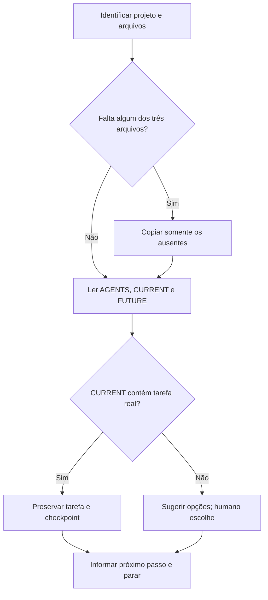

# Iniciar ou retomar SDD-Fast

Prepare o projeto e uma única tarefa para revisão humana. As regras permanentes estão em AGENTS.md.

## Fluxo

## 1. Identificar o estado

- Confirme a raiz do projeto. Examine a estrutura, o Git, os pontos de entrada e as validações pertinentes, ampliando a leitura somente conforme a necessidade.
- Verifique AGENTS.md, CURRENT_TASK.md e FUTURE_TASKS.md. Se AGENTS.md existir, leia suas regras antes de editar qualquer arquivo. Preserve as instruções já presentes.

## 2. Completar apenas arquivos ausentes

- Somente se faltar algum dos três arquivos, obtenha os modelos da cópia local do SDD-Fast indicada pelo humano. Se não houver caminho, procure uma cópia local reconhecível; como alternativa, consulte a branch develop de https://github.com/wjohnnyhonorato/sdd-fast, se acessível. Confirme a origem. Se não encontrar os modelos, solicite o caminho e pare; não improvise.
- Copie apenas os arquivos ausentes para a raiz do projeto. Nunca sobrescreva arquivos existentes.
- Se AGENTS.md foi copiado agora, preencha somente Contrato do projeto e Comandos com informações verificadas. Se faltar decisão de objetivo, usuário ou limite, peça-a ao humano.
- Se tiver acesso ao modelo do método e encontrar divergências nas seções fixas de um AGENTS.md existente, informe-as ao humano. Não altere essas seções nem refatore a arquitetura nesta etapa.

## 3. Preparar a tarefa

- Leia AGENTS.md, CURRENT_TASK.md e FUTURE_TASKS.md. As ideias futuras informam dependências e possíveis próximas tarefas; não constituem escopo aprovado.
- O humano pode pedir mudanças em FUTURE_TASKS.md em qualquer momento; sugira ideias quando pertinente, mas só registre, altere ou remova itens mediante pedido explícito dele.
- Se CURRENT_TASK.md contiver uma tarefa real, preserve seu escopo e seu checkpoint. Informe apenas conflitos ou dependências relevantes encontrados em FUTURE_TASKS.md.
- Se não houver tarefa real, apresente até duas opções concisas de FUTURE_TASKS.md; se ele contiver só o modelo vazio, use o Contrato do projeto. Peça ao humano que escolha ou descreva outra tarefa. Só então defina em CURRENT_TASK.md um comportamento principal, limites e validações com afirmação observável, resultado esperado e evidência verificável. Se a escolha ou um requisito decisivo estiver ausente, pare sem preencher a tarefa.

## 4. Encerrar

- Pare antes de implementar. Não instale dependências, crie código, rode testes extensos ou arquive tarefas.
- Confira os arquivos alterados. Se AGENTS.md mudou, verifique que apenas Contrato do projeto e Comandos foram editados.
- Responda brevemente: estado do projeto, arquivos preparados, tarefa atual e próximo passo ou decisão pendente. Não presuma aprovação da tarefa.
