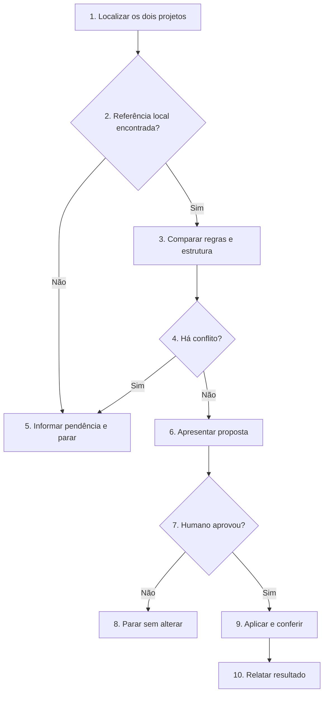

# Atualizar o SDD-Fast em um projeto

Compare o método instalado com o clone local do SDD-Fast. Preserve o trabalho produzido no projeto e aplique somente mudanças aprovadas pelo humano.

## Regras invariantes

1. Siga o Fluxo de decisão. Execução detalha os blocos de mesmo número; execute somente o caminho escolhido.
2. Use como referência a pasta `sdd-fast` na raiz do workspace: `AGENTS.md`, `CURRENT_TASK.md` e `scripts/sdd_check_task.py`. Se não a encontrar, peça ao humano o caminho local e pare.
3. Não faça clone, `fetch`, `pull` ou consultas remotas. O humano prepara e atualiza a pasta `sdd-fast` antes de chamar esta skill.
4. Preserve o conteúdo da tarefa ativa, `FUTURE_TASKS.md`, `tasks/`, código, testes e skills instaladas. Em `CURRENT_TASK.md`, acrescente apenas seções obrigatórias ausentes, sem substituir texto existente. Instale `scripts/sdd_check_task.py` somente se estiver ausente; não sobrescreva uma versão diferente sem decisão do humano.
5. Preserve integralmente `## Contrato do projeto` e `## Comandos` do `AGENTS.md` existente.
6. Não substitua `AGENTS.md` por uma cópia do modelo. Atualize apenas suas regras fixas, após apresentar as mudanças e receber aprovação explícita.
7. Se uma regra nova contrariar o projeto, se a origem de um trecho alterado for incerta, se houver seção equivalente com outro nome ou se a tarefa atual depender de um formato antigo, informe o conflito. Não resolva a divergência por conta própria.
8. Não implemente tarefas, instale dependências, execute testes do projeto, arquive tarefas ou crie commits.

## Fluxo de decisão

## Execução

1. **Localizar os dois projetos.** Identifique a raiz do projeto em atualização e a pasta `sdd-fast` na raiz do workspace. Leia os dois `AGENTS.md`, o `CURRENT_TASK.md` atual e os arquivos de referência citados na regra 2. Verifique alterações já existentes no projeto, sem modificá-las.
2. **Referência local encontrada?** Se os três arquivos de referência estiverem disponíveis, vá ao item 3. Caso contrário, vá ao item 5; não busque na internet.
3. **Comparar regras e estrutura.** Compare seções fixas de `AGENTS.md`, seções obrigatórias de `CURRENT_TASK.md` e presença do script. Preserve contrato, comandos, texto e checkpoint da tarefa. Não carregue tarefas arquivadas.
4. **Há conflito?** Verifique regras locais alteradas, seção equivalente com outro nome, conteúdo que não possa ser associado à estrutura nova ou script existente diferente. Se houver conflito não resolvido, vá ao item 5; caso contrário, vá ao item 6.
5. **Informar pendência e parar.** Indique o caminho local que falta ou mostre o conflito e a decisão necessária. Não altere arquivos.
6. **Apresentar proposta.** Indique a referência local, as regras que mudariam, seções a acrescentar em `CURRENT_TASK.md` e eventual instalação do script. Informe regras aplicáveis somente a tarefas futuras. Não apresente diff extenso.
7. **Humano aprovou?** A aprovação deve cobrir as mudanças propostas. Sem ela, vá ao item 8; com ela, vá ao item 9.
8. **Parar sem alterar.** Mantenha todos os arquivos como estão e informe o que falta decidir.
9. **Aplicar e conferir.** Atualize somente as regras fixas aprovadas em `AGENTS.md`. Na tarefa ativa, insira seções ausentes no lugar correspondente, mantendo todo o texto, validações e checkpoint; se faltar Atritos, inicie com `- Estado: ainda não avaliado.` e nunca presuma ausência de atrito. Se `CURRENT_TASK.md` for comprovadamente só o modelo vazio, pode substituí-lo pelo modelo novo. Copie o script apenas se ausente. Execute `uv run --no-sync python scripts/sdd_check_task.py open` se houver tarefa ativa. Confira que arquivos preservados não foram modificados. Não crie commit.
10. **Relatar resultado.** Informe referência, arquivos atualizados, resultado da checagem, regras que exigirão adaptação futura e limites da migração. Indique `AGENTS.md` e `CURRENT_TASK.md` para revisão humana no editor.
