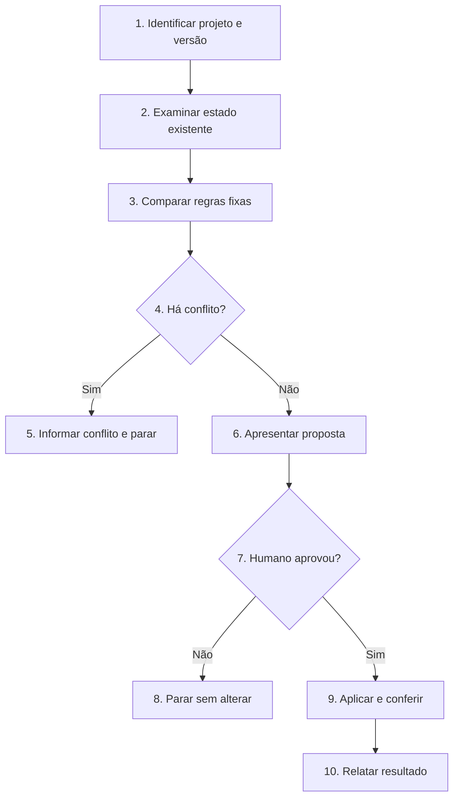

# Atualizar o SDD-Fast em um projeto

Compare as regras instaladas com a versão escolhida do método. Preserve o trabalho produzido no projeto e aplique somente mudanças aprovadas pelo humano.

## Regras invariantes

1. Siga o Fluxo de decisão. Execução detalha os blocos de mesmo número; execute somente o caminho escolhido.
2. Use a versão indicada pelo humano. Se ele não indicar uma, consulte a branch `main` de `https://github.com/wjohnnyhonorato/sdd-fast` e registre o commit usado.
3. Não altere `CURRENT_TASK.md`, `FUTURE_TASKS.md`, `tasks/`, código, testes ou skills instaladas.
4. Preserve integralmente `## Contrato do projeto` e `## Comandos` do `AGENTS.md` existente.
5. Não substitua `AGENTS.md` por uma cópia do modelo. Atualize apenas suas regras fixas, após apresentar as mudanças e receber aprovação explícita.
6. Se uma regra nova contrariar o projeto, se a origem de um trecho alterado for incerta ou se a tarefa atual depender de um formato antigo, informe o conflito. Não resolva a divergência por conta própria.
7. Não implemente tarefas, instale dependências, execute testes do projeto, arquive tarefas ou crie commits.

## Fluxo de decisão

## Execução

1. **Identificar projeto e versão.** Confirme a raiz do projeto, o `AGENTS.md` instalado e a versão de referência do SDD-Fast. Registre o commit da referência.
2. **Examinar estado existente.** Leia o `AGENTS.md` do projeto e verifique o estado do Git. Consulte `CURRENT_TASK.md` somente para identificar incompatibilidades; não altere seu conteúdo. Não carregue tarefas arquivadas.
3. **Comparar regras fixas.** Compare as seções fixas do `AGENTS.md` instalado com as da versão escolhida. Separe adições, alterações e remoções. Preserve o contrato e os comandos do projeto.
4. **Há conflito?** Verifique regras locais alteradas, mudanças não relacionadas já presentes em `AGENTS.md`, exigências incompatíveis com o projeto ou formato novo que dependa de editar a tarefa atual. Se houver conflito não resolvido, vá ao item 5; caso contrário, vá ao item 6.
5. **Informar conflito e parar.** Mostre o trecho afetado, as duas regras em disputa e a decisão necessária. Não altere arquivos.
6. **Apresentar proposta.** Informe a versão de origem identificável, a versão de destino, as seções que mudariam e qualquer regra nova que só poderá ser aplicada em tarefas futuras. Não apresente um diff extenso no chat.
7. **Humano aprovou?** A aprovação deve se referir às mudanças propostas. Sem ela, vá ao item 8; com ela, vá ao item 9.
8. **Parar sem alterar.** Mantenha todos os arquivos como estão e informe o que falta decidir.
9. **Aplicar e conferir.** Altere somente as regras fixas aprovadas em `AGENTS.md`. Confira o diff e verifique que contrato, comandos, tarefa atual, tarefas futuras, histórico, código e skills não foram modificados por esta execução. Não crie commit.
10. **Relatar resultado.** Informe o commit de referência, as seções atualizadas, as regras que exigirão adaptação em tarefas futuras e qualquer limite da migração. Indique `AGENTS.md` para revisão humana no editor.
