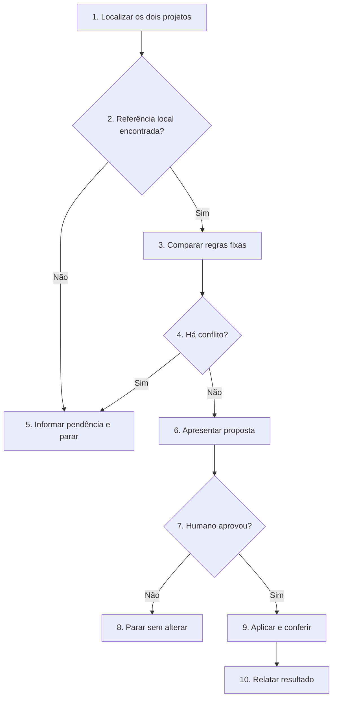

# Atualizar o SDD-Fast em um projeto

Compare as regras instaladas no projeto com o `AGENTS.md` do clone local do SDD-Fast. Preserve o trabalho produzido no projeto e aplique somente mudanças aprovadas pelo humano.

## Regras invariantes

1. Siga o Fluxo de decisão. Execução detalha os blocos de mesmo número; execute somente o caminho escolhido.
2. Use como referência `sdd-fast/AGENTS.md`, na pasta `sdd-fast` da raiz do workspace. Se não encontrar essa pasta, peça ao humano o caminho local e pare.
3. Não faça clone, `fetch`, `pull` ou consultas remotas. O humano prepara e atualiza a pasta `sdd-fast` antes de chamar esta skill.
4. Não altere `CURRENT_TASK.md`, `FUTURE_TASKS.md`, `tasks/`, código, testes ou skills instaladas.
5. Preserve integralmente `## Contrato do projeto` e `## Comandos` do `AGENTS.md` existente.
6. Não substitua `AGENTS.md` por uma cópia do modelo. Atualize apenas suas regras fixas, após apresentar as mudanças e receber aprovação explícita.
7. Se uma regra nova contrariar o projeto, se a origem de um trecho alterado for incerta ou se a tarefa atual depender de um formato antigo, informe o conflito. Não resolva a divergência por conta própria.
8. Não implemente tarefas, instale dependências, execute testes do projeto, arquive tarefas ou crie commits.

## Fluxo de decisão

## Execução

1. **Localizar os dois projetos.** Identifique a raiz do projeto em atualização e a pasta `sdd-fast` na raiz do workspace. Leia o `AGENTS.md` de cada uma. Verifique as alterações já existentes no projeto, sem modificá-las.
2. **Referência local encontrada?** Se `sdd-fast/AGENTS.md` estiver disponível, vá ao item 3. Caso contrário, vá ao item 5; não busque o arquivo na internet.
3. **Comparar regras fixas.** Compare as seções fixas dos dois arquivos. Separe adições, alterações e remoções. Preserve o contrato e os comandos do projeto. Consulte `CURRENT_TASK.md` somente para identificar incompatibilidades; não carregue tarefas arquivadas.
4. **Há conflito?** Verifique regras locais alteradas, exigências incompatíveis com o projeto ou formato novo que dependa de editar a tarefa atual. Se houver conflito não resolvido, vá ao item 5; caso contrário, vá ao item 6.
5. **Informar pendência e parar.** Indique o caminho local que falta ou mostre as regras em conflito e a decisão necessária. Não altere arquivos.
6. **Apresentar proposta.** Informe o caminho do arquivo de referência, as seções que mudariam e qualquer regra nova que só poderá ser aplicada em tarefas futuras. Não apresente um diff extenso no chat.
7. **Humano aprovou?** A aprovação deve se referir às mudanças propostas. Sem ela, vá ao item 8; com ela, vá ao item 9.
8. **Parar sem alterar.** Mantenha todos os arquivos como estão e informe o que falta decidir.
9. **Aplicar e conferir.** Altere somente as regras fixas aprovadas em `AGENTS.md`. Confira internamente que contrato, comandos, tarefa atual, tarefas futuras, histórico, código e skills não foram modificados por esta execução. Não crie commit.
10. **Relatar resultado.** Informe o caminho da referência local, as seções atualizadas, as regras que exigirão adaptação em tarefas futuras e qualquer limite da migração. Indique `AGENTS.md` para revisão humana no editor.
