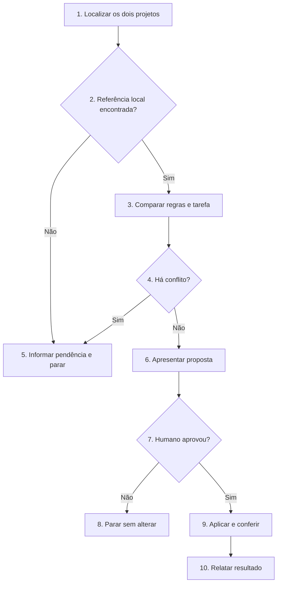

# Atualizar o SDD-Fast em um projeto

Compare o método instalado com `AGENTS.md` e `CURRENT_TASK.md` do clone local do SDD-Fast. Preserve o trabalho produzido no projeto e aplique somente mudanças aprovadas pelo humano.

## Regras invariantes

1. Siga o Fluxo de decisão. Execução detalha os blocos de mesmo número; execute somente o caminho escolhido.
2. Use como referência `sdd-fast/AGENTS.md` e `sdd-fast/CURRENT_TASK.md`, na pasta `sdd-fast` da raiz do workspace. Se não encontrar esses arquivos, peça ao humano o caminho local e pare.
3. Não faça clone, `fetch`, `pull` ou consultas remotas. O humano prepara e atualiza a pasta `sdd-fast` antes de chamar esta skill.
4. Preserve a tarefa ativa em `CURRENT_TASK.md`: acrescente apenas seções obrigatórias ausentes, sem substituir escopo, validações, atritos ou checkpoint existentes. Não altere `FUTURE_TASKS.md`, `tasks/`, código, testes ou skills instaladas.
5. Preserve integralmente `## Contrato do projeto` e `## Comandos` do `AGENTS.md` existente.
6. Não substitua `AGENTS.md` por uma cópia do modelo. Atualize apenas suas regras fixas, após apresentar as mudanças e receber aprovação explícita.
7. Se uma regra nova contrariar o projeto, se a origem de um trecho alterado for incerta ou se uma seção da tarefa atual tiver outro nome ou estrutura ambígua, informe o conflito. Não resolva a divergência por conta própria.
8. Não implemente tarefas, instale dependências, execute testes do projeto, arquive tarefas ou crie commits.

## Fluxo de decisão

## Execução

1. **Localizar os dois projetos.** Identifique a raiz do projeto em atualização e a pasta `sdd-fast` na raiz do workspace. Leia os dois `AGENTS.md` e os dois `CURRENT_TASK.md`. Verifique alterações já existentes no projeto, sem modificá-las.
2. **Referência local encontrada?** Se os dois arquivos de referência estiverem disponíveis, vá ao item 3. Caso contrário, vá ao item 5; não busque na internet.
3. **Comparar regras e tarefa.** Compare as seções fixas dos `AGENTS.md` e identifique seções obrigatórias ausentes em `CURRENT_TASK.md`. Preserve contrato, comandos e todo o conteúdo da tarefa. Não carregue tarefas arquivadas.
4. **Há conflito?** Verifique regras locais alteradas, exigências incompatíveis, seções com outro nome ou conteúdo da tarefa que não possa ser associado com segurança ao modelo. Se houver conflito não resolvido, vá ao item 5; caso contrário, vá ao item 6.
5. **Informar pendência e parar.** Indique o caminho local que falta ou mostre as regras em conflito e a decisão necessária. Não altere arquivos.
6. **Apresentar proposta.** Informe os arquivos de referência, as seções fixas que mudariam, as seções a acrescentar na tarefa e qualquer regra nova aplicável só a tarefas futuras. Não apresente um diff extenso no chat.
7. **Humano aprovou?** A aprovação deve se referir às mudanças propostas. Sem ela, vá ao item 8; com ela, vá ao item 9.
8. **Parar sem alterar.** Mantenha todos os arquivos como estão e informe o que falta decidir.
9. **Aplicar e conferir.** Altere somente as regras fixas aprovadas em `AGENTS.md`. Em `CURRENT_TASK.md`, acrescente apenas seções ausentes do modelo, preservando texto, validações, atritos e checkpoint existentes. Se faltar a seção de atritos, inicie com `- Estado: ainda não avaliado.`; não presuma ausência de atrito. Confira internamente que contrato, comandos, conteúdo anterior da tarefa, tarefas futuras, histórico, código e skills não foram modificados. Não crie commit.
10. **Relatar resultado.** Informe as referências locais, as seções atualizadas, as regras que exigirão adaptação futura e os limites da migração. Indique `AGENTS.md` e `CURRENT_TASK.md` para revisão humana no editor.
