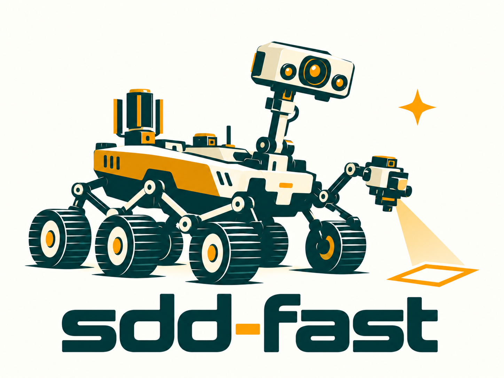

  

# SDD-Fast

Um método leve para desenvolver com coding agents. Você define um **Contrato do projeto** curto, com objetivo e limites gerais, e escolhe **uma pequena tarefa por vez** para avançar nessa direção. O agente implementa e apresenta evidências; você revisa, aceita ou pede correções. O aprendizado ajuda a escolher a próxima tarefa.

Não é preciso detalhar todas as entregas nem criar um roadmap antes de começar.

## 1. Começar em um projeto

1. Copie [AGENTS.md](AGENTS.md), [CURRENT_TASK.md](CURRENT_TASK.md) e [FUTURE_TASKS.md](FUTURE_TASKS.md) para a raiz do projeto.
2. Em `AGENTS.md`, preencha **Contrato do projeto** e **Comandos** com informações reais. Preserve as demais regras.
3. Escolha a primeira pequena entrega. Em `CURRENT_TASK.md`, preencha **O que fazer**, **O que não fazer** e **Como validar**. Revise a tarefa antes de pedir sua implementação.

Se quiser ajuda para iniciar ou retomar o projeto, instale [sddstart](.agents/skills/sddstart/) conforme a seção **Skills** e chame `/sddstart`. Ela prepara os arquivos e, após sua escolha, pode preencher a tarefa para revisão. Para antes de implementar.

## 2. Trabalhar em uma tarefa

Após aprovar `CURRENT_TASK.md`, peça ao agente:

> Leia `AGENTS.md`, `CURRENT_TASK.md` e `FUTURE_TASKS.md`. Examine o código relacionado e execute somente a tarefa atual. Apresente resultados verificáveis e aguarde minha revisão antes de arquivar.

1. **Construir:** o agente lê o contexto necessário e faz a menor mudança que atende à tarefa. Se o trabalho crescer ou gerar entregas independentes, atualiza o **Checkpoint** com estado, próximo passo e bloqueios e propõe tarefas menores.
2. **Validar:** para cada item de **Como validar**, o agente apresenta a afirmação observável, o resultado esperado e a evidência que você pode inspecionar ou reproduzir. Exemplo: “O pipeline termina → gera `resultado.csv` → executar `uv run python main.py` e inspecionar o arquivo”.
3. **Corrigir:** se uma validação falhar, peça a correção dentro do escopo e uma nova verificação. Se o escopo ou um critério precisar mudar, revise `CURRENT_TASK.md` e aprove a mudança antes de continuar. Não enfraqueça um critério apenas para fazê-lo passar.
4. **Revisar:** examine os arquivos e os resultados. Peça correções ou aprove a entrega. A afirmação “os testes passaram” não substitui a evidência.
5. **Fechar:** antes de commits preparados pelo agente e ao concluir, ele avalia e registra os atritos em `CURRENT_TASK.md`, inclusive quando não observou nenhum. Após sua aprovação, arquiva a tarefa em `tasks/` e restaura o modelo completo de `CURRENT_TASK.md`.
6. **Repetir:** escolha a próxima pequena tarefa com base no contrato, no que aprendeu e, se útil, em `FUTURE_TASKS.md`. Não precisa chamar `sddstart` a cada tarefa.

Prefira uma nova sessão do agente para cada tarefa. O **Checkpoint** permite retomar uma tarefa pausada sem transformar o arquivo em diário de comandos.

## 3. Arquivos do projeto

| Arquivo | Papel |
|---|---|
| `AGENTS.md` | Regras permanentes e contrato geral do projeto. |
| `CURRENT_TASK.md` | Única tarefa ativa: comportamento, limites, validação, atritos e checkpoint. |
| `FUTURE_TASKS.md` | Lembretes de possíveis trabalhos; não autorizam execução. |
| `tasks/` | Histórico das tarefas aprovadas; não precisa ser lido a cada nova tarefa. |

Você pode pedir ao agente para incluir, alterar ou remover lembretes em `FUTURE_TASKS.md` a qualquer momento. Ele pode sugerir ideias, mas **só modifica esse arquivo quando você pedir**.

Em projetos Python de modelagem, o [AGENTS.md](AGENTS.md) define a estrutura com `main.py`, módulos em `src/`, `config.yml`, `notebooks/validate_pipeline.ipynb` e `uv`. O `main.py` executa o fluxo completo; o notebook permite inspecionar cada etapa.

## 4. Skills: instalar e usar

Se quiser usar as skills em **todos os seus projetos no Windows**, copie a pasta de cada skill deste repositório para o diretório pessoal do agente, mantendo o arquivo `SKILL.md`:

| Agente | Exemplo para `sddstart` |
|---|---|
| Claude Code | `C:\Users\<nome_do_user>\.claude\skills\sddstart\SKILL.md` |
| Devin CLI | `C:\Users\<nome_do_user>\.agents\skills\sddstart\SKILL.md` |

Repita para `sddupdate` e `sddfriction` se quiser usá-las. Depois, chame `/sddstart`, `/sddupdate` ou `/sddfriction` quando necessário. As skills são opcionais; as regras do desenvolvimento ficam nos arquivos do projeto. Consulte os caminhos na documentação do [Claude Code](https://code.claude.com/docs/en/skills) e do [Devin CLI](https://docs.devin.ai/cli/extensibility/skills/overview) se seu agente não encontrar a skill.

| Skill | Quando chamar |
|---|---|
| [sddstart](.agents/skills/sddstart/) | Ao iniciar ou retomar o método em um projeto. |
| [sddupdate](.agents/skills/sddupdate/) | Para atualizar o método em um projeto que já o utiliza. |
| [sddfriction](.agents/skills/sddfriction/) | Quando você quiser analisar atritos recorrentes nas tarefas arquivadas. |

## 5. Atualizar um projeto antigo

1. Atualize seu clone local de `sdd-fast` na raiz do workspace e copie manualmente a versão atual de `sddupdate` para suas skills.
2. No projeto a atualizar, chame `/sddupdate`.
3. Revise e aprove a proposta antes das mudanças. A skill preserva contrato, comandos e conteúdo já escrito na tarefa ativa; apenas completa seções obrigatórias ausentes. Ela não altera tarefas arquivadas nem outras skills.
4. Atualize manualmente as demais skills que você usa.

## 6. Melhorar o método com o uso

O **Kaizen** corrige problemas observados que se repetem, sem acrescentar regras por precaução. Você conduz a revisão:

1. Durante a tarefa, o agente registra em `CURRENT_TASK.md` os atritos observados, com fato, impacto e evidência. Se nenhum foi observado, registra isso.
2. Ao fechar, você revisa esse registro antes de aprovar o arquivamento em `tasks/`.
3. Quando perceber repetição, chame `/sddfriction`. A skill examina tarefas arquivadas e propõe uma pequena melhoria, ou nenhuma.
4. Confira as tarefas citadas. Aceite, ajuste ou descarte a proposta; só então peça uma mudança no método.
5. Observe nas próximas tarefas se a mudança ajudou.

As decisões e fontes do método estão em [RATIONALE.md](RATIONALE.md). Leituras complementares: [DORA — lotes pequenos](https://dora.dev/capabilities/working-in-small-batches/) e [Thoughtworks — SDD](https://www.thoughtworks.com/radar/techniques/spec-driven-development).
