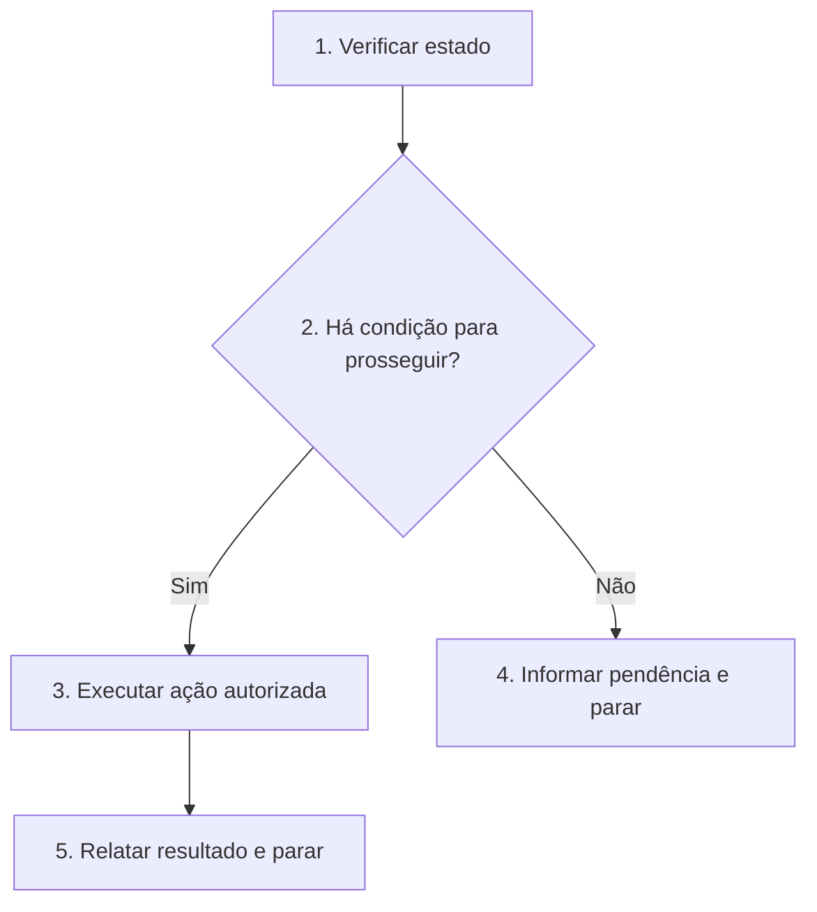

# <Nome da skill>

<Resultado que esta skill deve entregar em uma frase.>

## Regras invariantes

1. Siga o Fluxo de decisão pelas setas e condições. Execute somente os blocos do caminho escolhido; Execução detalha os blocos de mesmo número. Se fluxo e texto divergirem, pare e informe o humano.
2. Verifique o estado existente antes de criar ou alterar arquivos. Reutilize o que já atende ao objetivo.
3. <Limites e ações que esta skill nunca pode realizar por conta própria.>
4. <Decisões reservadas ao humano e o que exige aprovação explícita.>
5. Se faltar informação decisiva, informe a pendência e pare; não presuma uma resposta.

## Fluxo de decisão

## Execução

1. **Verificar estado.** <O que ler e como reconhecer trabalho já feito.>
2. **Há condição para prosseguir?** <Condição observável para seguir ao item 3 ou parar no item 4.>
3. **Executar ação autorizada.** <Ação, escopo e evidência mínima necessária.>
4. **Informar pendência e parar.** <O que informar sem alterar o estado.>
5. **Relatar resultado e parar.** <Resultado, evidências, limitações e próximo passo em poucas linhas.>
